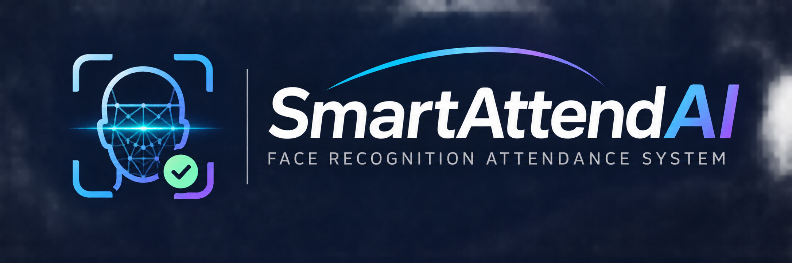
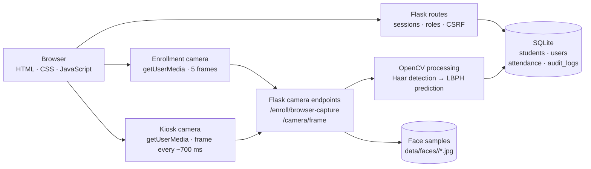

# SmartAttendAI

**Smart Attendance Management System using Flask, OpenCV, LBPH face recognition, and SQLite.**

[](https://smartattend-ai-y05d.onrender.com)

<p align="center">
  <a href="https://smartattend-ai-y05d.onrender.com">
    
  </a>
</p>

SmartAttendAI is a role-based attendance web application. Faculty enroll students using a browser camera, the attendance kiosk captures a check-in frame, and the Flask server uses OpenCV face detection and an LBPH model to identify a student and record attendance in SQLite.

> **Live site:** [https://smartattend-ai-y05d.onrender.com](https://smartattend-ai-y05d.onrender.com) · [Open the attendance kiosk](https://smartattend-ai-y05d.onrender.com/kiosk) · [GitHub repository](https://github.com/NARAYANA31587/2400031587NARAYANA_SLPROJ)
>
> The live app may need to wake up after inactivity. This free-host deployment uses temporary local storage: its database and face samples may be lost after a restart or redeploy. Use test data only.

## Project at a glance

| Area | Implementation |
|---|---|
| Web application | Python 3, Flask, Jinja templates |
| Face detection | OpenCV Haar cascade |
| Face recognition | OpenCV-contrib LBPH face recognizer |
| Database | SQLite |
| Browser interface | HTML, CSS, JavaScript, responsive layouts |
| Browser camera | `getUserMedia` over HTTPS or localhost |
| Production web server | Gunicorn |
| Hosting | Render Free web service, connected to GitHub |

## Features

- One-time initial setup for an administrator account.
- Role-based sign-in for administrators and faculty.
- Student directory with student ID and name search.
- Browser-camera face enrollment that captures five samples for a student.
- Public attendance kiosk with live camera preview, face boxes, recognition labels, and status colors.
- Automatic daily attendance insertion on a recognized face; duplicate attendance for the same student and date is ignored.
- Protected attendance records with date and student search.
- Date-range attendance reports and CSV export.
- Admin tools for creating/disabling faculty accounts and viewing recent audit events.
- A health-check endpoint for deployment monitoring.

## Application architecture



### Face-enrollment flow

1. An authorized faculty member enters a student ID and name.
2. The browser requests camera permission using `navigator.mediaDevices.getUserMedia`.
3. The browser captures five frames and posts them to `/enroll/browser-capture` with the session CSRF token.
4. Flask decodes and normalizes the frames, saves face samples, creates or updates the student record, and trains the LBPH recognizer.

### Attendance-kiosk flow

1. A check-in device opens `/kiosk` over HTTPS and grants camera permission to the browser.
2. The browser captures a frame about every 700 ms and posts it to `/camera/frame`.
3. OpenCV detects faces and LBPH compares them with the enrolled samples.
4. A recognized student is marked present for the current date. The response includes normalized face-box coordinates and a status for the browser overlay.

The kiosk browser uses the **check-in device's** camera. A cloud service such as Render does not have access to a webcam attached to your personal computer; the hosted recognition flow therefore sends frames from the browser to the Flask service for processing. Camera frames from the kiosk request are not saved as enrollment images; enrolled samples are stored separately.

## Pages and routes

| Route | Purpose | Access |
|---|---|---|
| `/setup` | Create the first administrator; redirects to sign-in once an account exists | Public until the first admin is created |
| `/login` | Administrator and faculty sign-in | Public |
| `/logout` | End the current session | Signed-in user |
| `/` | Dashboard totals, recent check-ins, and model status | Admin or faculty |
| `/students` | Search the student directory | Admin or faculty |
| `/enroll` | Enrollment form and browser camera preview | Admin or faculty |
| `/enroll/browser-capture` | Receive and store browser-captured enrollment samples | Admin or faculty |
| `/kiosk` | Public check-in page | Public kiosk |
| `/camera/frame` | Process a browser camera frame and mark recognized attendance | Kiosk frame endpoint |
| `/attendance` | Daily attendance register with filters | Admin or faculty |
| `/reports` | Date-range attendance report | Admin or faculty |
| `/reports.csv` | Download report data as CSV | Admin or faculty |
| `/faculty` | Create and manage faculty accounts | Admin only |
| `/faculty/<user_id>/toggle` | Enable or disable a faculty account | Admin only |
| `/audit` | View the latest audit events | Admin only |
| `/healthz` | Service health check | Public |

## User interface and visual design

The interface combines a dark fixed navigation rail with a light dashboard workspace. On narrow screens the navigation and page grids adapt to a compact layout.

### Typography

- **DM Sans** is the primary interface font for body text, labels, and controls.
- **Manrope** is used for headings, hero text, and prominent metric values.
- Both are loaded from Google Fonts, with local system sans-serif fallbacks.

### Color palette

| Token | Color | Use |
|---|---|---|
| Ink | `#182235` | Primary text |
| Muted | `#7d8798` | Secondary text |
| Page background | `#f6f7fa` | Main workspace |
| Navigation | `#111827` | Sidebar and kiosk background |
| Purple | `#6558dc` | Primary brand and actions |
| Green | `#1caa78` | Present status and success accents |
| Amber | `#e6a23c` | Waiting and absent metrics |
| Blue | `#448bd8` | Supporting metric accents |
| Recognized face | `#46cd82` | Kiosk recognition box |
| Unknown face | `#ffa500` | Kiosk unknown-face box |
| Recognition error | `#e64b4b` | Kiosk unavailable/error box |

### Page structure and headings

- **Sign-in:** SmartAttendAI banner and mark, “SECURE FACULTY PORTAL,” “Welcome back.”
- **Initial setup:** branded account-creation card, “ONE-TIME SETUP,” “Create administrator.”
- **Admin workspace:** left sidebar sections for Workspace and Administration; a top header with page breadcrumb and signed-in user/role.
- **Dashboard:** “Make every check-in count.” hero, student/present/awaiting/model metric cards, recent activity, and quick actions.
- **Student directory:** searchable table for student name, ID, enrollment date, and registration state.
- **Face enrollment:** student details, live camera preview with oval guide, consent note, and three-step guide panel.
- **Attendance kiosk:** standalone full-screen dark interface with “CONTACTLESS CHECK-IN,” live preview, colored face boxes, camera status, and faculty sign-in link.
- **Attendance register and reports:** white card panels, date/search toolbars, responsive tables, status pills, and CSV export action.
- **Faculty accounts and audit trail:** administrator-only account management and security-event tables.

Brand assets are in [`static/`](static/): `smartattend-logo-banner.png` (full banner) and `smartattend-mark.png` (compact icon). The styling is in [`static/style.css`](static/style.css), with kiosk camera overlays in [`static/kiosk-camera.css`](static/kiosk-camera.css).

## Database and face-sample storage

SQLite is the application's only database; no database migration is performed. The tables are:

- `students`: student ID, name, and creation timestamp.
- `attendance`: student, date, and marked time, with a unique student/date constraint.
- `users`: account name, password hash, role, activation state, and creation timestamp.
- `audit_logs`: account actions and timestamps.

The app uses `CREATE TABLE IF NOT EXISTS`, so database initialization does not drop the existing student or attendance tables. Face samples are JPEG files stored under `data/faces/<student_id>/`.

Storage configuration:

- `SMARTATTEND_DATA_DIR` sets the data/faces directory. Default: `<project>/data`.
- `SMARTATTEND_DB` sets the SQLite database file. Default: `<SMARTATTEND_DATA_DIR>/smartattend.db`.

The local database and face files are intentionally excluded from Git. Back up both separately before making changes.

## Security and privacy

- Passwords are stored using Werkzeug password hashing; plaintext account passwords are not stored.
- Authenticated state uses Flask's signed session cookie. Authenticated POSTs are protected with a session CSRF token.
- Session cookies are `HttpOnly` and `SameSite=Lax`; secure cookies can be enabled with `SESSION_COOKIE_SECURE=true` when serving the site over HTTPS.
- `SECRET_KEY` is read from the environment. `SMARTATTEND_SECRET` is supported for backwards compatibility. If neither exists, a random development key is generated at process start; sessions will not survive a restart.
- The kiosk does not render a student directory or attendance register. Its camera endpoint returns recognition status and the label for a matched face so the kiosk can show the check-in result.
- Enroll face data only with informed consent and provide a manual attendance alternative. LBPH is a basic prototype method: it can fail or falsely match and does not provide liveness/anti-spoofing.

## Local development

### Windows

1. Install 64-bit Python 3.11 or 3.12.
2. Open PowerShell in this project folder.
3. Start the app:

   ```powershell
   .\run_windows.bat
   ```

4. Open `http://127.0.0.1:5001/setup` to create the first administrator, then sign in.
5. Keep the terminal running. Press `Ctrl+C` to stop the server.

The batch launcher creates `.venv` and installs `requirements.txt` automatically. To install and run manually:

```powershell
py -3.11 -m venv .venv
.\.venv\Scripts\Activate.ps1
python -m pip install -r requirements.txt
python app.py
```

Allow camera access in the browser. `getUserMedia` works on localhost in supported browsers.

## GitHub and free Render deployment

The project is configured for a Render Blueprint in [`render.yaml`](render.yaml). To deploy from GitHub:

1. Push the project to a GitHub repository. The current repository is [`NARAYANA31587/2400031587NARAYANA_SLPROJ`](https://github.com/NARAYANA31587/2400031587NARAYANA_SLPROJ).
2. In [Render](https://dashboard.render.com/), select **New → Blueprint**, connect the repository, and select the branch containing `render.yaml`.
3. Review the Blueprint and choose the **Free** service plan. Do not add a paid disk or paid services.
4. Wait for the deployment. Open the public HTTPS address Render shows on the service page.
5. Open `/setup` on the deployed site to create the initial admin account.

Render settings:

| Setting | Value |
|---|---|
| Build command | `pip install -r requirements.txt` |
| Start command | `gunicorn --workers 1 --threads 4 --timeout 120 --bind 0.0.0.0:$PORT app:app` |
| Instance | Free |
| Python | 3.12 |

`app:app` tells Gunicorn to import the `app` module and serve its Flask `app` object. Render supplies `PORT`; the process binds to `0.0.0.0`.

The Blueprint generates `SECRET_KEY` and sets `SESSION_COOKIE_SECURE=true`. `PORT` is supplied by Render. `SMARTATTEND_DATA_DIR` and `SMARTATTEND_DB` are optional; leave them unset to use the service's default data directory.

### Free-host limitations

- A free service can sleep after inactivity, so the first visit may take longer while it wakes.
- Free hosting does **not** provide this app with a persistent disk. SQLite records and face samples written to local service storage can be erased during restart or redeploy.
- Do not use the free deployment as the sole store for real attendance data or student biometric information. Keep test data only.
- Frame processing, model training, and attendance requests depend on the free service being awake and responsive.
- No free hosting provider can promise that a public app will remain online forever.

## Project structure

```text
SmartAttendAI_Redesign/
├── app.py                  # Flask routes, SQLite, OpenCV detection/LBPH
├── requirements.txt        # Flask, NumPy, OpenCV contrib, Gunicorn
├── render.yaml             # Render Free Blueprint
├── run_windows.bat         # Windows setup and local launcher
├── data/                   # Local SQLite database and face samples (not committed)
├── static/
│   ├── style.css           # Dashboard, forms, tables, responsive layout
│   ├── kiosk-camera.css    # Kiosk camera overlay and status colors
│   ├── smartattend-mark.png
│   └── smartattend-logo-banner.png
└── templates/              # Jinja pages for auth, dashboard, kiosk, and reports
```

## Dependencies

- Flask 3.x
- NumPy
- `opencv-contrib-python` 4.x (includes `cv2.face` / LBPH)
- Gunicorn 22–23 for hosted deployment
